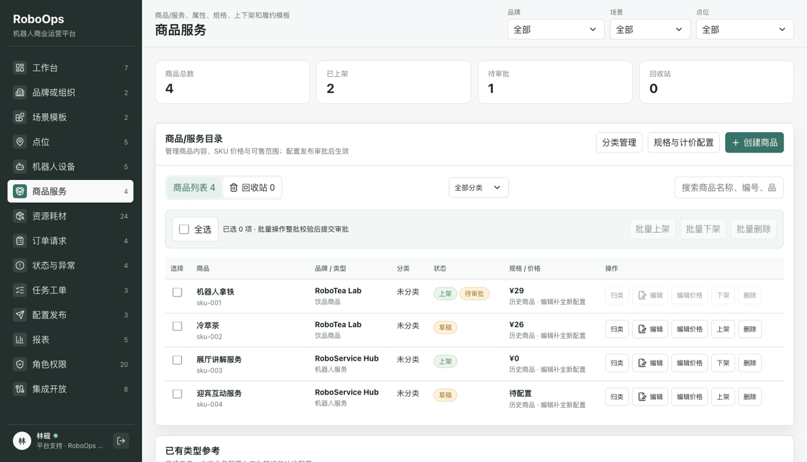
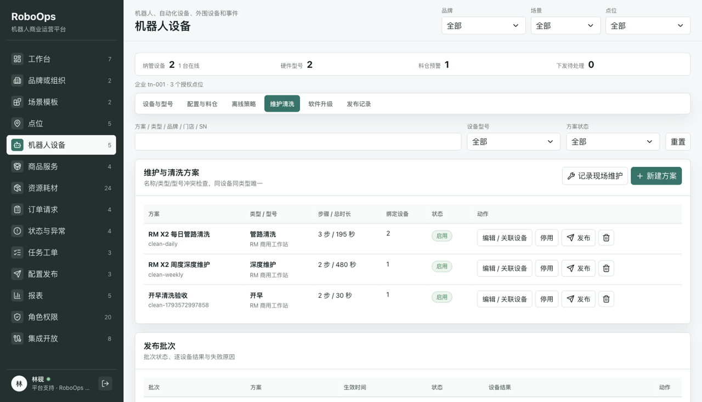
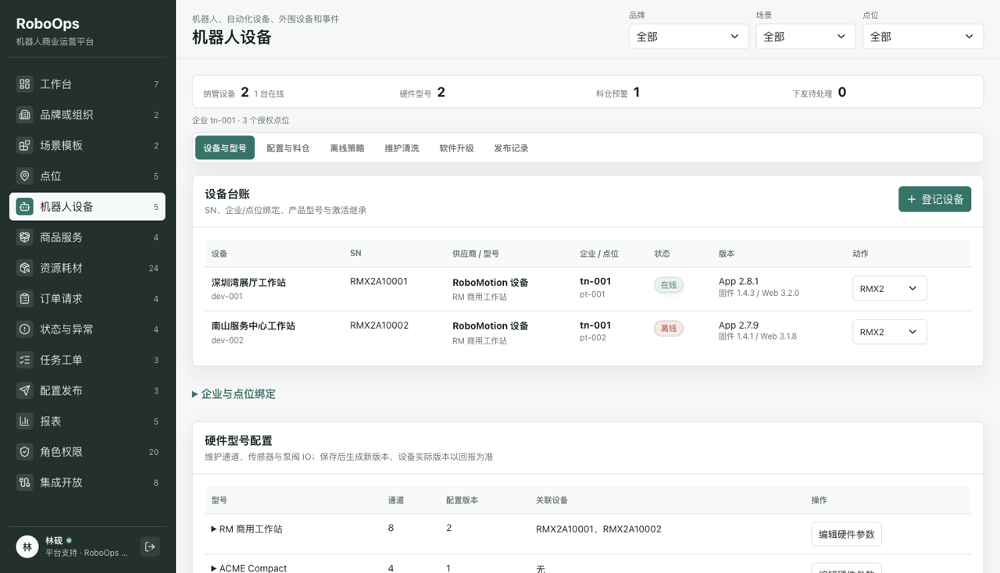

# RoboOps

当前版本：**v0.3.2**。

面向机器人商业运营的前端 MVP，覆盖点位、设备、商品、订单、异常、任务、审批与报表。

## v0.3.2 本次更新：商品管理、清洗方案与设备配置

本次更新围绕商品日常维护、设备清洗管理、硬件型号配置与状态同步展开，并调整后台布局，提高信息查看和操作效率。

### 商品管理

入口：**商品服务**（`/catalog`）。

- **回收站管理**：支持商品移入回收站、恢复和永久删除，保留历史订单与操作记录。
- **名称查重**：回收站商品不参与同品牌名称查重；恢复时重新检查名称冲突，并保持下架，重新上架需审批。
- **商品卖点**：默认每条最多 20 字，可不填写；填写时从 1 条开始。
- **商品简介**：默认字数上限由 50 字增加至 200 字。

动图展示：商品目录 → 回收站恢复与删除入口 → 卖点和简介编辑。



### 清洗管理

入口：**机器人设备 → 设备运营 → 维护清洗**（`/devices/operations`）。

- **方案管理**：支持新增、编辑、启停和删除，可按方案名称、类型、品牌、型号、门店及设备 SN 查找。
- **设备关联**：按型号选择适用设备，校验设备兼容性及同设备、同类型方案的绑定冲突。
- **步骤配置**：支持清洗方式、单/双路、执行时长、操作说明和执行前再次确认；步骤可添加、删除和调整顺序。
- **记录追踪**：方案发布记录与实际清洗记录分别保留，便于查看下发结果和现场执行情况。

动图展示：方案列表 → 方案信息与关联设备 → 清洗步骤配置。



### 设备型号配置与状态同步

入口：**机器人设备 → 设备运营 → 设备与型号 / 配置与料仓**。

- **型号参数维护**：配置通道数量、传感器与执行器数量、泵阀及传感器 IO，以及回抽、糖桶清洗等能力。
- **SN 与型号关联**：设备按 SN 关联型号，展示型号能力、关联设备及配置版本。
- **启动配置同步**：提供 APP 启动配置，包含硬件参数及可用商品、物料、配方、工艺和清洗计划；配置保存与设备实际应用版本分别记录。
- **运行状态展示**：接收设备 MQTT 状态回报，按实际设备展示通道、传感器读数、物料绑定和余量。
- **自动刷新与时效提示**：展示最近上报时间，自动刷新状态，并区分离线、无上报及数据过期。

动图展示：设备概览 → 型号硬件参数 → 通道 IO → 设备实际配置与状态。



### 排版与操作效率

- **商品列表**：使用完整内容宽度，恢复、永久删除等按钮保持完整文字，避免逐字换行。
- **设备选择**：修复复选框尺寸，设备 SN 与点位分行对齐，便于快速识别和勾选。
- **信息密度**：设备和订单运营使用紧凑摘要；工作台、资源和状态页在手机端使用双列统计，优先露出业务列表与操作入口。
- **控件一致性**：筛选框与重置按钮等高、底部对齐；设备型号、退款选择单位及状态筛选器统一边框、箭头、焦点和禁用样式，复选框与单选框统一主题色；文字操作按钮按内容撑开，避免受图标按钮的固定宽度挤压。
- **表单与窄屏布局**：统一清洗步骤、输入区与操作按钮的间距，低频内容按需展开；手机端标签单行滚动，编辑表单适配屏幕宽度。

## v0.3.1 历史更新：商品分类管理与商品归类

围绕商品分类维护、历史商品归类和审批一致性，补齐业务人员直接操作的管理入口。

- **分类配置**：按品牌新增分类，维护名称、排序和启停状态，校验同品牌重名；分类改名或停用保留历史商品关联。
- **商品归类与筛选**：新建及编辑商品可选择分类，列表支持按分类、未分类筛选；提供独立“归类”入口，历史商品无需补齐图片、卖点或规格即可调整分类。
- **发布审批与回退**：已上架商品调整分类进入审批，批准前保留原归属；分类审批和回退只更新分类，不改写 SKU、价格或后续商品配置。
- **业务复审**：区分在用、回收站及待审批关联数；审批时展示提交名称和目标当前名称、启停状态；拦截并行、过期及已删除商品的分类回退。
- **历史兼容与权限**：原商品无分类时显示“未分类”，按品牌隔离可选项及审计范围，保留停用分类的历史展示，并适配窄屏操作，无需重置已有浏览器数据。

## v0.3.0 历史更新：商品管理与新增点位

扩展商品创建、规格计价、图片与发布流程，并新增点位创建及可配置字段，沿用已有权限、数据范围和审批机制。

- **商品完整维护**：提供基础资料、规格价格、商品图片、可售范围分步编辑；支持图片上传、封面设置、原价与活动价，以及历史服务商品兼容编辑。
- **规格与计价模板**：按品牌维护规格组、选项、启停排序、必选规则和计价维度；支持多维价格矩阵及统一价格，保留稳定 SKU、历史价格与商品配置快照。
- **业务规则配置**：商品名、卖点、简介及图片数量规则可在后台维护；明确应用模板后更新商品，新默认模板不直接覆盖已保存商品。
- **批量操作与审批**：支持批量上下架、删除和恢复，整批校验后生成逐商品发布记录；经营配置审批后生效，回收站恢复后保持下架。
- **点位创建与字段配置**：新增点位表单和详情展示，支持文本、数字、选项、必填及范围校验；按品牌维护字段模板，停用选项保留历史值，兼顾权限隔离、刷新持久化和移动端使用。

## v0.2.2 历史更新：退款 / 退单管理（2026-09-20）

新增退款 / 退单管理模块，入口为 **订单请求 → 退款 / 退单管理**，覆盖订单筛选、申请确认、审批处理、结果追踪和异常恢复。

- **管理视图与批量操作**：新增订单处理、退款记录、批次记录三个视图，支持多条件筛选、当前页批量选择，以及单笔和批量退款/退单；原订单详情与异常退款入口可直接跳转。
- **整单关联与金额校验**：支持小程序整单和后台子单关联选择，分别保存父支付金额与子单实付分摊，支持部分退款、剩余可退金额校验；缺少支付关联的历史订单明确拦截。
- **退款与退单策略**：独立展示履约、设备退单和支付退款状态，支持先退单再退款或独立退款；失败订单支持免审核及人工/自动退款，其他状态按策略直接退款、提交审核或禁止退款。
- **确认与结果追踪**：提交前逐单说明处理方式、金额及跳过原因，提交后展示成功、失败、结果未知、待审核和待退单等状态，保留批次汇总与逐单明细。
- **审批与异常恢复**：支持审核通过/驳回、退款失败重试、未知结果查询和退单失败恢复，区分发起人与审核人，并通过订单详情查看关联子单及操作时间线。
- **权限、审计与演示场景**：接入账号权限、点位数据范围和主系统审计，提供当前范围的演示订单恢复入口，保留外部明细、支付关联及渠道退款号等对接字段，并适配窄屏操作。

详细功能、场景矩阵与操作步骤见 [退款退单管理与验收](docs/22-退款退单管理与验收.md)。该版本演示使用模拟支付与设备回执。

## 快速使用

推荐 Node.js 22，在仓库目录执行：

```bash
cd app
npm ci
npm run dev
```

本地地址：<http://127.0.0.1:5173/>。演示账号：林砚 / `usr-000`；审批账号：沈乔 / `usr-010`。演示密码：`RoboOps@2026`。

检查命令：`npm run check`、`npm test`、`npm run build`。

[线上演示](https://roboops-console.pages.dev/) · [GitHub 仓库](https://github.com/techfanseric/RoboOps)。线上版本以最近一次成功部署为准。

## 历史版本

| 版本 | 更新摘要 |
| --- | --- |
| v0.2.2 | 退款 / 退单管理：父子订单、批量退款、审批与失败重试。 |
| v0.2.1 | 状态与异常中心：设备状态、状态字典、异常规则与配置发布。 |
| v0.2.0 | 补齐规格配方、资源耗材、设备运维、订单报表及开放集成。 |

## 版本管理

应用版本以 `app/package.json` 为准，`app/package-lock.json` 和两份 README 同步维护。新增功能递增功能版本（如 `0.2.2 → 0.3.0`），缺陷修复递增修订版本，重大不兼容变更递增主版本。数据结构版本及设备固件版本独立管理。

v0.3.0 的业务配置补齐沿用同一功能版本；商品分类更新使用 **v0.3.1**，本次反馈整合递增为 **v0.3.2**，属于兼容现有数据的增量交付。

## 其他文档

- [工程运行说明](app/README.md)
- [项目文档索引](docs/00-项目索引.md)
- [退款退单验收](docs/22-退款退单管理与验收.md)
- [旧后台能力实施记录](docs/20-旧后台能力补全最终变更总账.md)
- [部署与 CI/CD](docs/18-免费云部署与CICD实施.md)
