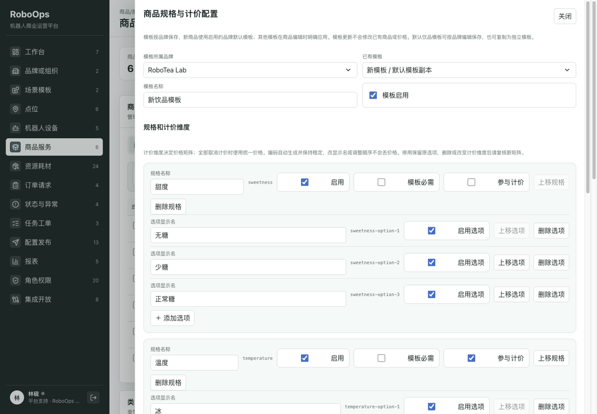
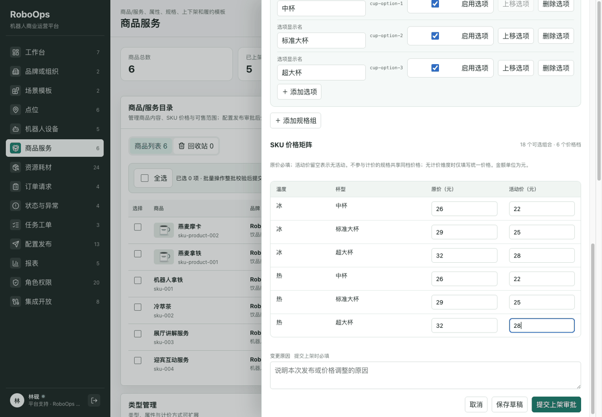
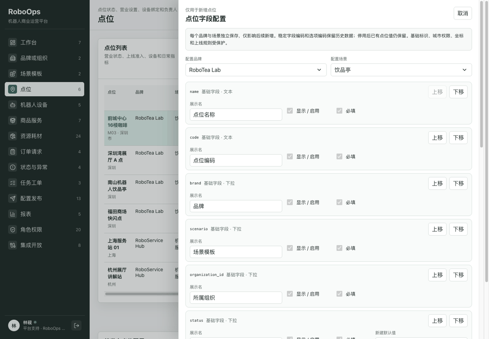
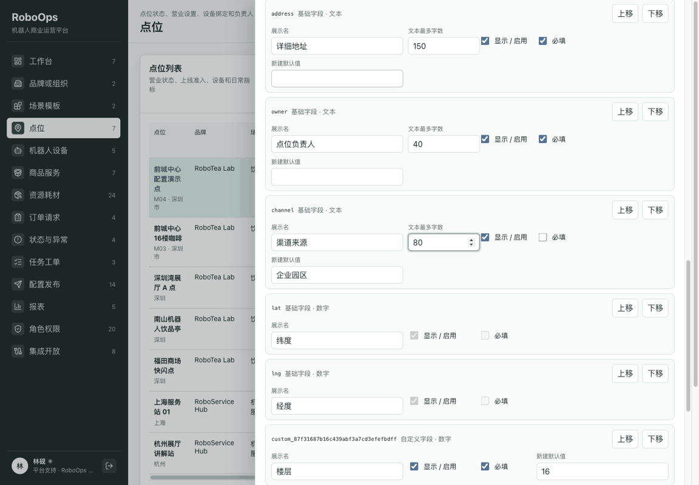

# RoboOps

当前版本：**v0.3.0**（本地验收通过；线上更新以部署流水线结果为准）。

面向机器人商业运营的前端 MVP，覆盖点位、设备、商品、订单、异常、任务、审批与报表。

## v0.3.0：商品管理与新增点位（2026-10-12）

入口：**商品服务**（`/catalog`）及 **点位 → 新增点位**（`/points`）。本次更新沿用现有权限、数据范围和配置审批机制。

### 业务人员界面配置（本次补齐）

配置范围限定为商品规格、计价和点位字段。业务人员可在界面保存配置，无需修改代码；已有模块仅联动权限、审批、审计及资料展示。

- **商品服务 → 规格与计价配置**：按品牌维护默认模板，也可复制或新增独立模板；配置规格组、选项、名称、顺序、启用状态、是否必选及是否参与计价。默认仍为甜度、温度、杯型；可指定任意规格参与计价，也可使用统一价格。
- **商品资料限制**：在模板中配置名称、卖点数量及长度、简介长度、图片数量。默认保留需求中的 15 字、2–4 条 × 8 字、50 字、1–3 张；资源上限为 6 个规格组、每组 8 个选项、64 档价格，名称 100 字、卖点 10 条 × 100 字、简介 2000 字、图片 10 张。
- **应用模板与历史兼容**：品牌默认模板自动用于后续新建商品；已有商品保留自己的规格与限制快照。独立模板由商品编辑页显式应用，可保留匹配规格编码的价格或清空重填。规格和选项使用稳定编码，改名、排序不会丢失原价及活动价，SKU 编号也保持对应组合不变；停用的价格行及编号保留，重新启用后可恢复。
- **点位 → 字段配置**：按品牌和场景配置字段名称、默认值、必填、显示、顺序及文本长度（1–1000 字，编码格式仍固定）；支持新增文本、数字、下拉、日期、是/否字段。下拉选项可改名和停用，编码保持稳定。新增点位使用对应配置，并在详情中展示自定义字段。
- **点位历史与约束**：停用字段或选项后保留旧值，详情仍可查看；已保存字段如需换类型，新增字段并停用旧字段。身份、品牌组织关系、城市权限、初始状态及坐标约束继续保留，防止配置绕过唯一性、权限和成对坐标校验。配置与模板遵循现有业务权限和品牌数据范围。

验收示例：商品模板将名称上限改为 25 字后，新商品立即采用，旧商品仍保留 15 字；“大杯”改名后六档价格不变。点位新增必填数字“楼层”（默认 16）及下拉“运营方式”，新建页自动带入默认值，缺失必填项无法保存；停用“合作”后新点位无法选择，历史点位仍显示“合作”。

业务操作复审修复：初始状态默认值“筹备中”正确带入新建页；切换品牌或场景更新自动默认值，保留明确填写且仍显示的资料，停用字段不会隐藏保存旧草稿值。文本长度可在界面调整；数字输入框滚动时不再误改数值。商品审批前后展示全部规格和规则，包括不参与计价的甜度选项，支持审批人确认变更。旧类型表标为只读参考，避免误认为配置入口；未新增全平台配置能力。

### 商品功能更新

- **创建及编辑基础信息**：默认商品名最多 15 个字，卖点 2–4 条、每条最多 8 个字，简介最多 50 个字；按所用模板提供字数提示和提交校验。
- **可配置 SKU**：默认甜度为无糖、少糖、正常糖，温度为冰、热，杯型为中杯、大杯、超大杯。规格组选项及是否参与定价可配置，默认生成杯型 × 温度的 6 档价格，甜度作为选择项。
- **原价与活动价**：创建、编辑、提交上架时可编辑完整价格矩阵；列表提供独立改价入口。金额最多两位小数，活动价可留空且不能高于原价。
- **商品图片**：默认支持上传、预览和移除 1–3 张 JPG/PNG/WebP，数量按模板校验。建议尺寸 800 × 600；按原比例缩小并压缩，原图最大 5 MB。图片独立保存，审批快照保留引用，减少重复占用浏览器存储。
- **商品管理**：支持创建、上架、下架、编辑、软删除和恢复；上架、下架、删除、恢复均可批量选择处理。回收站保留已删除商品，恢复后需重新上架。
- **发布与审计**：创建草稿直接保存，经营相关变更进入配置审批，通过后生效。已有待审批变更时阻止重复提交；批量提交前统一校验，提交后逐商品审批。发起人不能审批自己的申请。
- **可售联动**：价格矩阵同步到 SKU 目录，按稳定商品 ID 关联；草稿、下架及已删除商品不计入点位可售范围或开业准入。

### 新增点位更新

- **完整资料**：名称、编码、品牌、场景、所属组织、省、市、区县、地址、负责人、初始状态、经纬度及渠道，覆盖需求示例的全部字段。
- **关联及校验**：品牌关联同企业的组织，场景来自已配置模板；校验名称及编码唯一、必填项、长度、角色及数据范围。经纬度可同时留空，填写时必须成对且处于合法范围。
- **上线准备**：初始状态为待上线或筹备中，自动创建负责人、设备、商品、异常规则和营业确认检查；后续营业状态调整沿用配置审批。
- **系统联动**：保存后展示新点位及完整详情，更新品牌/组织点位数量，接通筛选、审计及订单报表资料；兼容“深圳”和“深圳市”的城市权限匹配。

### 操作演示与验收

商品模板配置、应用，以及新旧商品限制的区别：



规格改名保留价格、切换统一计价、提交上架并审批：



点位字段配置、默认值、必填校验、保存详情及停用选项后的历史展示：



复审补充演示：点位文本长度、筹备状态默认值与范围切换，以及非计价规格变更的审批差异。



基础流程 GIF：[商品创建与图片上传](docs/screenshots/products-points/product-create.gif)、[批量管理与回收站](docs/screenshots/products-points/product-batch.gif)、[新增点位与上线检查](docs/screenshots/products-points/point-create.gif)。

窄屏验收：[商品规格配置（390px）](docs/screenshots/business-configuration/product-mobile.png)、[点位动态字段（390px）](docs/screenshots/business-configuration/point-mobile.png)。GIF 由真实浏览器关键操作截图逐帧组成；基础批量演示包含两件商品的删除、恢复和重新上架。

使用林砚 / `usr-000` 登录（演示密码见下文），创建商品时填写基础资料、上传图片、录入价格并选定可售点位；保存草稿后从列表改价或提交上架。在配置审批中由其他有权限的账号处理申请，生效后再验收批量下架、删除和恢复。新增点位可按“前城中心16楼咖啡 / M03”示例填写，坐标和渠道留空；刷新后检查资料仍在且上线准入为待处理。

当前仍为前端 MVP：资料及图片保存在当前浏览器，审批与 SKU 同步用于本地演示，尚未接通真实小程序商品 API、服务器图片存储或设备商品发布。推送 `main` 后由现有流水线构建并部署线上演示。

验证结果：190 项测试、TypeScript 类型检查和生产构建通过；覆盖模板作用域、默认值、历史快照、稳定规格与 SKU 编码、价格迁移、统一计价、动态字段、文本长度、范围切换及权限校验。浏览器验证配置保存及刷新、商品创建与图片上传、价格保留、非计价规格的审批差异、点位筹备状态默认值、范围切换、必填及停用选项的历史展示，并检查 390px 窄屏。基础批量下架、删除/恢复/重新上架已验收；历史机器人服务保留原 SKU、免费服务定价及编辑流程。

## 快速使用

推荐 Node.js 22，在仓库目录执行：

```bash
cd app
npm ci
npm run dev
```

本地地址：<http://127.0.0.1:5173/>。演示账号：林砚 / `usr-000`；审批账号：沈乔 / `usr-010`。演示密码：`RoboOps@2026`。

检查命令：`npm run check`、`npm test`、`npm run build`。

[线上演示](https://roboops-console.pages.dev/) · [GitHub 仓库](https://github.com/techfanseric/RoboOps)。线上版本以最近一次成功部署为准。

## 历史版本

| 版本 | 更新摘要 |
| --- | --- |
| v0.2.2 | 退款 / 退单管理：父子订单、批量退款、审批与失败重试。 |
| v0.2.1 | 状态与异常中心：设备状态、状态字典、异常规则与配置发布。 |
| v0.2.0 | 补齐规格配方、资源耗材、设备运维、订单报表及开放集成。 |

## 版本管理

应用版本以 `app/package.json` 为准，`app/package-lock.json` 和两份 README 同步维护。新增功能递增功能版本（本次 `0.2.2 → 0.3.0`），缺陷修复递增修订版本，重大不兼容变更递增主版本。数据结构版本及设备固件版本独立管理。

本次业务配置补齐属于同一次功能更新，版本继续保持 **v0.3.0**。

## 其他文档

- [工程运行说明](app/README.md)
- [项目文档索引](docs/00-项目索引.md)
- [退款退单验收](docs/22-退款退单管理与验收.md)
- [旧后台能力实施记录](docs/20-旧后台能力补全最终变更总账.md)
- [部署与 CI/CD](docs/18-免费云部署与CICD实施.md)
